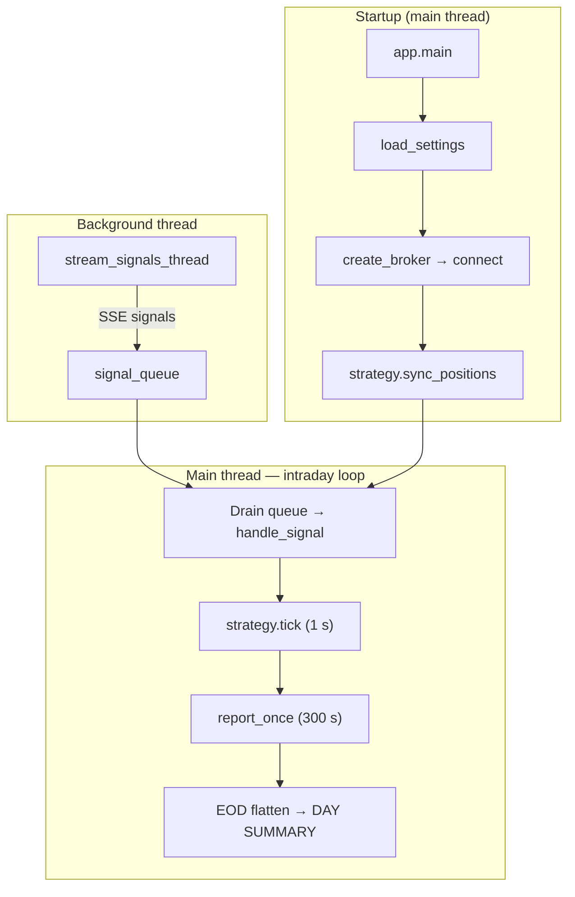
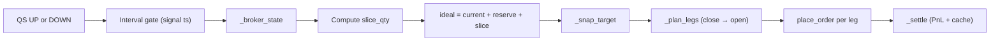

# Live Trader — Developer Documentation

Technical guide for engineers inheriting this codebase: system architecture, module map, trading algorithms (position sizing, execution logic), and local development.

**Operator quick start (Docker, env vars, deployment):** see [README.md](README.md).

**QuantumSignals API client only:** see [quantumsignals-client.md](quantumsignals-client.md).

---

## Table of contents

1. [Introduction](#1-introduction)
2. [System architecture & data flow](#2-system-architecture--data-flow)
3. [Repository & module map](#3-repository--module-map)
4. [Trading algorithms](#4-trading-algorithms)
5. [Configuration & extensibility](#5-configuration--extensibility)
6. [Local development & testing](#6-local-development--testing)
7. [Maintenance, edge cases & future work](#7-maintenance-edge-cases--future-work)

---

## 1. Introduction

### What this bot does

A long-running Python process that:

1. Streams minute-level ML signals from QuantumSignals (SSE)
2. Applies the `momentum` strategy (pluggable via `app._STRATEGIES`)
3. Places orders through the selected broker (`TRADER_BROKER`: `simulated` by default, or a real broker like Alpaca)
4. Flattens positions at session end and logs daily / run summaries

### Document map

| File | Audience |
|------|----------|
| [README.md](README.md) | Deploy and configure via Docker / `.env` |
| [architecture.md](architecture.md) (this file) | Code structure and trading logic |
| [brokers.md](brokers.md) | Broker plugin architecture; add your own broker |
| [quantumsignals-client.md](quantumsignals-client.md) | `quantumsignals-client` API usage |

### Tech stack

Python 3.12+, `uv` (workspace), `loguru`, `python-dotenv`, `pydantic-settings`, `quantumsignals-client` (≥ 0.9.0), `alpaca-py`, `pytest`. (Broker SDKs live in their broker packages.)

---

## 2. System architecture & data flow

### High-level flow



### Initialization (`app.main`)

Order of operations in [`src/trader/app.py`](src/trader/app.py):

| Step | Action |
|------|--------|
| 1 | `_setup_logging()` — stderr + first day log file |
| 2 | `load_settings()` — `.env` + env vars + optional `--execution-interval` |
| 3 | `create_broker(settings)` → `broker.connect()` |
| 4 | `_log_signal_catalog()` — QS signal catalog + subscriptions (best-effort) |
| 5 | Instantiate strategy from `app._STRATEGIES` |
| 6 | `strategy.sync_positions()` — broker → strategy state |
| 7 | Start daemon thread `stream_signals_thread()` |
| 8 | Enter multi-day supervisor loop |

### Intraday event loop

`_run_trading_day()` polls roughly every 50ms:

| Cadence | Call | Purpose |
|---------|------|---------|
| Continuous | Drain `signal_queue` → `strategy.handle_signal()` | React to QS signals |
| 1 s | `strategy.tick()` | Optional time-driven hooks (default no-op) |
| 300 s | `report_once(broker, perf)` | Account NLV, positions, bot PnL |
| Session end | `datetime >= TRADER_SESSION_END_TIME` | Exit loop → EOD flatten |

### Threading model

**Critical:** [`streaming.py`](src/trader/streaming.py) runs QS I/O in a daemon thread and only enqueues signal objects. The **main thread** executes all broker / strategy calls — a broker SDK may require thread affinity (bound to the event loop of the thread that connected it).

```
QS stream thread  →  signal_queue  →  main thread (strategy + broker)
```

### Multi-day supervisor

When `TRADER_RUN_DAYS=0` (default), the process runs until Ctrl-C:

1. `_compute_next_session_window()` — next weekday `TRADER_SESSION_START_TIME` → `TRADER_SESSION_END_TIME`
2. If before start → `_sleep_until()` (discards off-hours signals from queue)
3. Pre-session `strategy.sync_positions()` again
4. `_run_trading_day()` until EOD
5. `_close_all_positions()` if `TRADER_CLOSE_ON_EXIT`
6. `_log_day_summary()` → `perf.reset()` → `strategy.reset_for_new_day()`
7. Sleep until next weekday (weekends skipped; **no US holiday calendar**)

**Logs:** `logs/session_<YYYY-MM-DD>_<HH-MM-SS>.log` where `HH-MM-SS` is process start time. Same-day restart → second file.

### State ownership

| State | Owner | Notes |
|-------|-------|-------|
| Open positions | **Broker** | Source of truth; momentum re-fetches on every execution |
| Net qty, reserve, decisions | **Strategy** | In-memory cache; synced / reset per day |
| Closed-trade PnL, signal counts | **`PerformanceTracker`** | `perf.reset()` between days |
| Buffered signals | **`queue.Queue`** | Optional cap via `TRADER_SIGNAL_QUEUE_MAXSIZE` |

### Shutdown paths

| Event | Behavior |
|-------|----------|
| Invalid QS API key | Stream sets `stop_event`, process exits |
| Transient QS errors | Backoff, max 5 retries (`Settings.max_stream_retries`) |
| Ctrl-C | Flatten if `TRADER_CLOSE_ON_EXIT`, day summary, RUN SUMMARY |
| `TRADER_RUN_DAYS=N` | Exit after N completed EODs |

---

## 3. Repository & module map

### Tree

```
live-trader/                # uv workspace root (the app)
├── main.py                 # → trader.app:main
├── docs/architecture.md    # This file
├── README.md               # Operator quick start
├── pyproject.toml          # app deps + [tool.uv.workspace]
├── .env.example
├── Dockerfile / docker-compose.yml
├── src/trader/             # the app package
│   ├── app.py              # Orchestration, session supervisor, EOD
│   ├── config.py           # app Settings (orchestration), multipliers
│   ├── access_control.py   # startup QS + broker entitlement checks
│   ├── models.py           # Signal enum, PerformanceTracker
│   ├── streaming.py        # QS SSE → queue
│   ├── reporting.py        # report_once snapshots
│   ├── brokers/            # create_broker discovery only (no concrete brokers)
│   └── strategy/           # momentum
├── src/symbols/            # qs-trader-symbols: QS catalog, alias normalization, broker maps
│   └── tests/              #   catalog tests
├── src/brokers/            # broker packages (uv workspace members)
│   ├── core/               # qs-trader-broker-core: BrokerBase, OrderResult, SimulatedBroker
│   │   └── tests/          #   package's own tests (SimulatedBroker)
│   └── alpaca/             # qs-trader-broker-alpaca (deps: alpaca-py)
├── tests/                  # app-level tests (config, strategies, models, access control)
└── scripts/                # QS smoke test, multiday sim
```

### Layer responsibilities

| Layer | Files | Key entry points |
|-------|-------|------------------|
| Entry | `main.py` | `main()` |
| Orchestration | `app.py` | `main`, `_run_trading_day`, `_close_all_positions`, `_sleep_until` |
| Config | `config.py` | `Settings`, `load_settings` |
| Access | `access_control.py` | `run_startup_access_checks` |
| Symbols | `src/symbols/` (`qs_trader_symbols`) | `canonicalize`, `parse_allowed_symbols`, broker map helpers |
| Ingestion | `streaming.py` | `stream_signals_thread` |
| Execution | `trader/brokers/` (discovery) + `src/brokers/*` (packages) | `create_broker`, `BrokerBase` implementations |
| Logic | `strategy/*` | `MomentumStrategy` |
| Metrics | `models.py`, `reporting.py` | `PerformanceTracker`, `report_once` |

### Brokers (separate workspace packages)

Brokers are plugins: separate uv workspace packages under `src/brokers/`, each
owning its SDK and registered via a `qs_trader_brokers` entry point that
`create_broker` discovers at runtime. Full architecture, the `BrokerBase`
interface, and a "create your own broker" walkthrough live in
**[brokers.md](brokers.md)**.

Broker-specific quirks worth knowing here:

| Class | Notes |
|-------|-------|
| `AlpacaBroker` | Contract = ticker string; equities/ETFs only (futures rejected); HTTP timeouts on `requests.Session` |
| `SimulatedBroker` | Jittered seed prices (`SIM_PRICE_JITTER`, `0` = deterministic); no external broker |

### Strategies (`src/trader/strategy/`)

| Class | File | Role |
|-------|------|------|
| `StrategyBase` | `base.py` | `handle_signal`, optional `tick`, `sync_positions`, `reset_for_new_day` |
| `MomentumStrategy` | `momentum.py` | Interval-based sized slices |

Register new strategies in `app._STRATEGIES`.

### Helper scripts

| Script | Purpose |
|--------|---------|
| `scripts/smoke_qs_connection.py` | Validate API key; print signal stream |
| `scripts/smoke_multiday_supervisor.py` | Offline multi-day supervisor (stubbed QS, sim clock) |

---

## 4. Trading algorithms

### 4.1 Signal model

QuantumSignals emits objects consumed by `handle_signal(signal)`.

**Direction** (aligned with [`models.Signal`](src/trader/models.py)):

| Value | Enum | Meaning |
|-------|------|---------|
| `0` | `DOWN` | Bearish / sell slice |
| `1` | `STABLE` | Hold (strategy-specific) |
| `2` | `UP` | Bullish / buy slice |

**Null signals:** `signal.is_null_signal()` → logged and skipped.

**Symbol mapping** (QS signal → tradable instrument):

| QS `signal.symbol` | Alpaca (ETF) |
|--------------------|--------------|
| ES, S&P500 | SPY |
| NQ, Nasdaq100 | QQQ |
| SPY | SPY |
| QQQ | QQQ |

Defined in `qs_trader_symbols`. Each broker builds its tradable map from that catalog (see [brokers.md § Symbol maps](brokers.md#symbol-maps)).

Set `TRADER_ALLOWED_SYMBOLS` using **any alias** for an instrument (`ES`, `SPY`, or `S&P500` all select the same product). Empty = allow the full catalog.

---

### 4.2 `momentum` — position sizing & execution

Default strategy (`TRADER_STRATEGY=momentum`). Implements incremental position building on a fixed time grid.

#### Position sizing formula

From `_compute_order_qty()` in [`momentum.py`](src/trader/strategy/momentum.py):

```
TRADING_MINUTES_PER_DAY = 390                    # 6.5h US equity session
executions_per_day      = 390 // interval_minutes
qty_per_slice           = target_daily_notional_per_symbol / (executions_per_day × price)
```

**Budget split:**

```
target_daily_notional_per_symbol = TRADER_DAILY_START_CAPITAL / n_active_symbols
```

- `n_active_symbols` = count of canonical instruments from `trading_targets()` (minimum 1). Empty `TRADER_ALLOWED_SYMBOLS` → every instrument in the catalog.
- Example: `$100,000` capital, `TRADER_ALLOWED_SYMBOLS=ES,NQ` → **$50,000 notional per symbol per day**

**Broker rounding:**

| Broker | `use_fractional` (`BrokerBase.supports_fractional`) | Order qty |
|--------|------------------|-----------|
| Alpaca, Simulated | `true` | `round(raw, 4)` shares |
| non-fractional brokers | `false` | `max(1, round(raw))` whole shares |

Doubling `TRADER_EXECUTION_INTERVAL_MINUTES` halves `executions_per_day` and **doubles** `qty_per_slice`, keeping approximate daily notional stable.

#### Worked example

| Input | Value |
|-------|-------|
| `TRADER_DAILY_START_CAPITAL` | $100,000 |
| Active symbols | ES, NQ (2) |
| `TRADER_EXECUTION_INTERVAL_MINUTES` | 5 |
| `executions_per_day` | 390 / 5 = **78** |
| Per-symbol budget | $50,000 |
| SPY price | $545 |

```
qty_per_slice = 50_000 / (78 × 545) ≈ 1.1776 shares  (Alpaca)
```

On a whole-share broker the same inputs yield `max(1, round(1.1776)) = 1` share per slice.

#### Per-interval behavior (`handle_signal`)

1. Filter: null signal, `TRADER_ALLOWED_SYMBOLS` / `is_symbol_allowed()`, unknown names only as passthrough
2. **Interval gate:** at most one execution per symbol per `TRADER_EXECUTION_INTERVAL_MINUTES`, comparing the **signal's UTC timestamp** (floored to whole seconds) against `_last_exec_time` — not wall-clock arrival time. This keeps ES and NQ aligned when they share the same QS bar timestamp.
3. **STABLE:** no order; timer still updated
4. **UP / DOWN:** call `_execute()`

#### Broker-reconciled execution (`_execute`)

Each UP/DOWN tick re-reads the **broker position** (source of truth) and plans orders to reach a feasible target:

```
current, avail_close, avg_entry = _broker_state(broker, etf_symbol)
slice_qty = _compute_order_qty(...)
signed_slice = ±slice_qty  (UP / DOWN)
ideal = current + reserve + signed_slice
target, new_reserve = _snap_target(ideal, use_fractional)
legs = _plan_legs(current, target, avail_close, use_fractional)
```

**Feasible target** (`_snap_target`):

| Case | Alpaca (fractional) | Whole-share broker |
|------|--------|------|
| `ideal >= 0` | Hold fractional long exactly | `round(ideal)` whole shares |
| `ideal < 0` | `round(ideal)` whole-share short; remainder → `_position_reserve` | `round(ideal)` whole shares |

**Invariant:** `ideal = broker_position + reserve` (reserve = 0 while ideal is non-negative on Alpaca).

Alpaca rejects **fractional short** positions (error 42210000). The reserve accumulates sub-share short intent until `round()` crosses an integer boundary.

**Order legs** (`_plan_legs`): at most two legs — **close** the opposite side, then **open** the new side — because Alpaca requires separate close/open orders when crossing through flat. Close legs are capped to `qty_available` at the broker. After a close leg, `_wait_opposite_cleared()` polls until the opposite side is gone before emitting an open leg.

If a leg fails, the remainder of the slice is dropped; the next interval re-plans from fresh broker state (self-healing after partial fills, manual trades, or restarts).



#### Position sync & daily reset

**`sync_positions()`** (startup + pre-session):

- Debounced to once per 5 seconds (`_last_sync_time`)
- Retries broker fetch up to 3 times on network errors
- Clears `_net_qty`, `_total_cost`, `_position_reserve` only **after** a successful fetch
- Reads `broker.get_positions_for_sync()`; maps ETF ticker back to QS symbol (`SPY` → `ES`, `QQQ` → `NQ`)
- Ignores sub-lot dust shorts (≤ `_DUST_QTY`) when syncing
- Preserves `_last_exec_time` cooldown timers across syncs

**`reset_for_new_day()`** (after EOD flatten in `app.py`):

- Clears all per-symbol accumulators and interval timers

#### PnL tracking (momentum)

Realized PnL on **closes** (position crosses zero or flips sign) is recorded in `PerformanceTracker` inside `_settle()` after each execution tick. Open exposure is not marked-to-market in the bot tracker until flat.

---

### 4.3 App-level risk actions

**EOD / shutdown flatten** — `_close_all_positions()` in `app.py`:

- Iterates broker positions (not strategy dict)
- Market order to flat; PnL uses `contract_multipliers` from settings
- Records each close in `PerformanceTracker`

Realized PnL is tracked in `PerformanceTracker` (`record_close()` on strategy closes and EOD flatten).

---

## 5. Configuration & extensibility

Full operator reference (env vars, strategies, symbols, paper vs live): [README.md](README.md).

### Environment variables (algorithm impact)

| Variable | Effect |
|----------|--------|
| `TRADER_STRATEGY` | Strategy name (`momentum`) |
| `TRADER_DAILY_START_CAPITAL` | Per-symbol daily notional budget for order sizing |
| `TRADER_EXECUTION_INTERVAL_MINUTES` | Execution gate (one trade per symbol per interval) |
| `TRADER_ALLOWED_SYMBOLS` | Filters QS symbols (any alias: `ES`, `SPY`, `S&P500`) |
| `TRADER_BROKER` | Selects the broker (`simulated` = no real orders, the default); drives fractional vs whole-share sizing |
| `ALPACA_PAPER` | Paper vs live account when `TRADER_BROKER=alpaca` |

### Paper vs live (summary)

Two layers: `TRADER_BROKER` (`simulated` vs a real broker like `alpaca`) → the broker's own paper/live switch (e.g. `ALPACA_PAPER`). See [README.md § Paper Trading vs Live Trading](README.md#paper-trading-vs-live-trading).

### Symbol maps & code-only settings

Each broker owns its own symbol map (QS symbol → broker-native contract) as a
class attribute — see [brokers.md § Symbol maps](brokers.md#symbol-maps). The
one broker-neutral map that stays in the app is `contract_multipliers`
(`config.py`, `_DEFAULT_CONTRACT_MULTIPLIERS`) — the futures point-values used
for EOD-flatten PnL.

### Adding a strategy

1. Subclass `StrategyBase` in `src/trader/strategy/`
2. Implement `handle_signal`; override `tick`, `sync_positions`, `reset_for_new_day` as needed
3. Register in `app._STRATEGIES` dict
4. Add tests with `FakeSignal` pattern from `tests/test_strategy.py`

### Adding a broker

See **[brokers.md § Create your own broker](brokers.md#create-your-own-broker)**.

### Settings not loaded from environment

Present on `Settings` but **not** read in `load_settings()` today:

| Field | Default | Notes |
|-------|---------|-------|
| `max_stream_retries` | 5 | QS stream reconnect cap |
| `use_market_orders` | true | Broker behavior |

Requires code change to tune via `.env`.

---

## 6. Local development & testing

### Install and run

```bash
uv sync
cp .env.example .env   # set QUANTUMSIGNALS_API_KEY at minimum

# Safest: simulated broker (the default)
TRADER_BROKER=simulated uv run live-trader

# CLI override
uv run live-trader --execution-interval 10
```

See [README.md](README.md) for Alpaca paper trading and Docker.

### Automated tests

```bash
uv sync --group dev
uv run pytest -v
```

| File | Covers |
|------|--------|
| `tests/test_models.py` | `PerformanceTracker` |
| `tests/test_access_control.py` | Startup QS entitlement checks |
| `src/brokers/core/tests/test_simulated_broker.py` | `SimulatedBroker` (co-located with the core broker package) |
| `tests/test_strategy.py` | `MomentumStrategy` + `FakeSignal` |
| `src/symbols/tests/test_catalog.py` | QS symbol catalog |

No live broker or QS API in CI-style unit tests.

### Manual smoke tests

```bash
uv run python scripts/smoke_qs_connection.py
uv run python scripts/smoke_multiday_supervisor.py --days 3
```

`smoke_multiday_supervisor.py` stubs the QS thread and accelerates wall clock to verify multi-day logs and `TRADER_RUN_DAYS` exit in seconds.

---

## 7. Maintenance, edge cases & future work

### Edge cases

| Topic | Detail |
|-------|--------|
| QS disconnects | Exponential backoff; fatal after 5 retries |
| QS symbol formats | Futures roots (`ES`/`NQ`), full names (`S&P500`/`Nasdaq100`), ETF tickers (`SPY`/`QQQ`), and other catalog aliases |
| Interval gate | Momentum uses signal timestamp, not arrival time — sub-second QS timestamps are floored |
| Broker drift | Momentum re-reads broker every execution; strategy cache is advisory only |
| Holidays | Not detected — bot wakes; often empty day |
| Alpaca fractional shorts | Momentum reserve + close/open legs; do not remove without regression tests |
| Alpaca hung HTTP | Default timeouts in `AlpacaBroker` |
| Broker thread affinity | Never call broker from QS thread |
| Position drift | Pre-session `sync_positions()` — broker is truth |
| `TRADER_SESSION_END_TIME` | Default **15:55** ET — flatten before 16:00 auction |
| Signal queue full | Set `TRADER_SIGNAL_QUEUE_MAXSIZE` or speed up strategy |

### Recommended enhancements

- US market holiday calendar
- Expose `max_stream_retries` via env
- Health metric (last signal timestamp / stream alive)
- Structured metrics (Prometheus, CloudWatch)

---

## Quick reference — key code paths

| Question | Where to look |
|----------|----------------|
| How is order qty computed? | `momentum._compute_order_qty`, `_execute` |
| Why fractional reserve? | `MomentumStrategy.__init__` docstring; `_snap_target` |
| How are close/open legs planned? | `momentum._plan_legs`, `_broker_state` |
| When is EOD flatten? | `app._run_trading_day`, `_close_all_positions` |
| How are signals ingested? | `streaming.stream_signals_thread` |
| Broker selection? | `brokers.create_broker` |
| QS symbol catalog? | `qs_trader_symbols` |
| QS client usage? | [quantumsignals-client.md](quantumsignals-client.md) |
