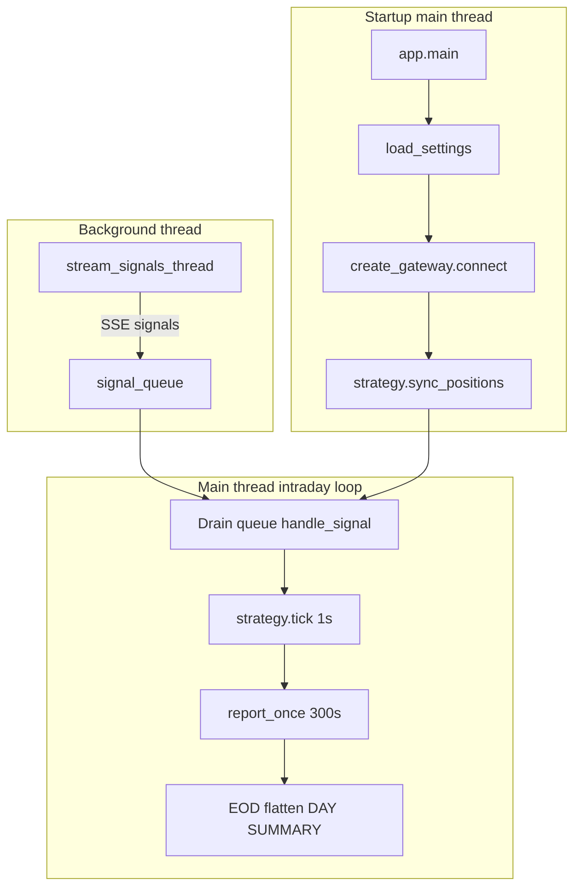
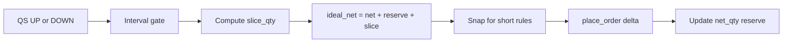

# Live Trader — Developer Documentation

Technical guide for engineers inheriting this codebase: system architecture, module map, trading algorithms (position sizing, execution logic), and local development.

**Operator quick start (Docker, env vars, deployment):** see [README.md](README.md).

**QuantumSignals API client only:** see [QS documentation.md](QS%20documentation.md).

---

## Table of contents

1. [Introduction](#1-introduction)
2. [System architecture & data flow](#2-system-architecture--data-flow)
3. [Repository & module map](#3-repository--module-map)
4. [Trading algorithms](#4-trading-algorithms)
5. [Configuration & extensibility](#5-configuration--extensibility)
6. [Local development & testing](#6-local-development--testing)
7. [Maintenance, edge cases & future work](#7-maintenance-edge-cases--future-work)

---

## 1. Introduction

### What this bot does

A long-running Python process that:

1. Streams minute-level ML signals from QuantumSignals (SSE)
2. Applies a pluggable strategy (`momentum` or `signal_follower`)
3. Places orders at Alpaca, IBKR, or a simulated broker (`DRY_RUN`)
4. Flattens positions at session end and logs daily / run summaries

### Document map

| File | Audience |
|------|----------|
| [README.md](README.md) | Deploy and configure via Docker / `.env` |
| **documentation.md** (this file) | Code structure and trading logic |
| [QS documentation.md](QS%20documentation.md) | `quantumsignals-client` API usage |

### Tech stack

Python 3.12+, `uv`, `loguru`, `python-dotenv`, `quantumsignals-client`, `alpaca-py`, `ib-async`, `pytest`.

---

## 2. System architecture & data flow

### High-level flow



### Initialization (`app.main`)

Order of operations in [`src/trader/app.py`](src/trader/app.py):

| Step | Action |
|------|--------|
| 1 | `_setup_logging()` — stderr + first day log file |
| 2 | `load_settings()` — `.env` + env vars + optional `--execution-interval` |
| 3 | `create_gateway(settings)` → `gw.connect()` |
| 4 | `_log_model_catalog()` — QS models (best-effort) |
| 5 | Instantiate strategy from `app._STRATEGIES` |
| 6 | `strategy.sync_positions()` — broker → strategy state |
| 7 | Start daemon thread `stream_signals_thread()` |
| 8 | Enter multi-day supervisor loop |

### Intraday event loop

`_run_trading_day()` polls roughly every 50ms:

| Cadence | Call | Purpose |
|---------|------|---------|
| Continuous | Drain `signal_queue` → `strategy.handle_signal()` | React to QS signals |
| 1 s | `strategy.tick()` | Time-driven logic (`signal_follower` close window) |
| 300 s | `report_once(gw, perf)` | Account NLV, positions, bot PnL |
| Session end | `datetime >= SESSION_END_TIME` | Exit loop → EOD flatten |

### Threading model

**Critical:** [`streaming.py`](src/trader/streaming.py) runs QS I/O in a daemon thread and only enqueues signal objects. The **main thread** must execute all `ib_async` / gateway / strategy calls because IBKR was connected on the main thread.

```
QS stream thread  →  signal_queue  →  main thread (strategy + gateway)
```

### Multi-day supervisor

When `RUN_DAYS=0` (default), the process runs until Ctrl-C:

1. `_compute_next_session_window()` — next weekday `SESSION_START_TIME` → `SESSION_END_TIME`
2. If before start → `_sleep_until()` (discards off-hours signals from queue)
3. Pre-session `strategy.sync_positions()` again
4. `_run_trading_day()` until EOD
5. `_close_all_positions()` if `CLOSE_ON_EXIT`
6. `_log_day_summary()` → `perf.reset()` → `strategy.reset_for_new_day()`
7. Sleep until next weekday (weekends skipped; **no US holiday calendar**)

**Logs:** `logs/session_<YYYY-MM-DD>_<HH-MM-SS>.log` where `HH-MM-SS` is process start time. Same-day restart → second file.

### State ownership

| State | Owner | Notes |
|-------|-------|-------|
| Open positions | **Broker** | Source of truth |
| Net qty, reserve, decisions | **Strategy** | In-memory; synced / reset per day |
| Closed-trade PnL, signal counts | **`PerformanceTracker`** | `perf.reset()` between days |
| Buffered signals | **`queue.Queue`** | Optional cap via `SIGNAL_QUEUE_MAXSIZE` |

### Shutdown paths

| Event | Behavior |
|-------|----------|
| Invalid QS API key | Stream sets `stop_event`, process exits |
| Transient QS errors | Backoff, max 5 retries (`Settings.max_stream_retries`) |
| Ctrl-C | Flatten if `CLOSE_ON_EXIT`, day summary, RUN SUMMARY |
| `RUN_DAYS=N` | Exit after N completed EODs |

---

## 3. Repository & module map

### Tree

```
live-trader/
├── main.py                 # → trader.app:main
├── documentation.md        # This file
├── README.md               # Operator quick start
├── pyproject.toml          # deps; console script live-trader
├── .env.example
├── Dockerfile / docker-compose.yml
├── src/trader/
│   ├── app.py              # Orchestration, session supervisor, EOD
│   ├── config.py           # Settings, symbol_map, multipliers
│   ├── models.py           # Signal enum, PerformanceTracker
│   ├── streaming.py        # QS SSE → queue
│   ├── reporting.py        # report_once snapshots
│   ├── gateways/           # Broker abstraction
│   └── strategy/           # momentum, signal_follower
├── tests/
└── scripts/                # tutorial, QS test, multiday sim
```

### Layer responsibilities

| Layer | Files | Key entry points |
|-------|-------|------------------|
| Entry | `main.py` | `main()` |
| Orchestration | `app.py` | `main`, `_run_trading_day`, `_close_all_positions`, `_sleep_until` |
| Config | `config.py` | `Settings`, `load_settings` |
| Ingestion | `streaming.py` | `stream_signals_thread` |
| Execution | `gateways/*` | `create_gateway`, `GatewayBase` implementations |
| Logic | `strategy/*` | `MomentumStrategy`, `SignalFollowerStrategy` |
| Metrics | `models.py`, `reporting.py` | `PerformanceTracker`, `report_once` |

### Gateways (`src/trader/gateways/`)

Factory in [`__init__.py`](src/trader/gateways/__init__.py):

```
DRY_RUN=true       → SimulatedGateway
BROKER=alpaca      → AlpacaGateway   (REST, ETFs, fractional longs)
BROKER=ibkr        → IBGateway       (ib_async, futures + stocks)
```

| Class | Notes |
|-------|-------|
| `GatewayBase` | `connect`, `resolve_contract`, `place_order`, `get_positions_for_sync`, … |
| `AlpacaGateway` | Contract = ticker string; HTTP timeouts on `requests.Session` |
| `IBGateway` | Qualifies futures from `symbol_map`; error 10197 = competing session |
| `SimulatedGateway` | Jittered `sim_prices`; no external broker |

### Strategies (`src/trader/strategy/`)

| Class | File | Role |
|-------|------|------|
| `StrategyBase` | `base.py` | `handle_signal`, optional `tick`, `sync_positions`, `reset_for_new_day` |
| `MomentumStrategy` | `momentum.py` | Interval-based sized slices; ETF mapping |
| `SignalFollowerStrategy` | `signal_follower.py` | 1 share/minute; ET session windows |

Register new strategies in `app._STRATEGIES`.

### Helper scripts

| Script | Purpose |
|--------|---------|
| `scripts/test_qs_connection.py` | Validate API key; print signal stream |
| `scripts/test_multiday_sim.py` | Offline multi-day supervisor (stubbed QS, sim clock) |
| `scripts/tutorial.py` | Interactive IBKR + QS walkthrough |

---

## 4. Trading algorithms

### 4.1 Signal model

QuantumSignals emits objects consumed by `handle_signal(signal)`.

**Direction** (aligned with [`models.Signal`](src/trader/models.py)):

| Value | Enum | Meaning |
|-------|------|---------|
| `0` | `DOWN` | Bearish / sell slice |
| `1` | `STABLE` | Hold (strategy-specific) |
| `2` | `UP` | Bullish / buy slice |

**Null signals:** `signal.is_null_signal()` → logged and skipped.

**Symbol mapping** (futures signal → ETF execution on Alpaca):

| QS `signal.symbol` | Traded ticker |
|--------------------|---------------|
| ES, S&P500 | SPY |
| NQ, Nasdaq100 | QQQ |

Defined in `_SIGNAL_TO_TRADE` in both strategy modules. IBKR can trade native futures when listed in `config._DEFAULT_SYMBOL_MAP`.

---

### 4.2 `momentum` — position sizing & execution

Default strategy (`STRATEGY=momentum`). Implements incremental position building on a fixed time grid.

#### Position sizing formula

From `_compute_order_qty()` in [`momentum.py`](src/trader/strategy/momentum.py):

```
TRADING_MINUTES_PER_DAY = 390                    # 6.5h US equity session
executions_per_day      = 390 // interval_minutes
qty_per_slice           = target_daily_notional_per_symbol / (executions_per_day × price)
```

**Budget split:**

```
target_daily_notional_per_symbol = DAILY_START_CAPITAL / n_active_symbols
```

- `n_active_symbols` = count of keys in `_SIGNAL_TO_TRADE` that pass `ALLOWED_SYMBOLS` (minimum 1)
- Example: `$100,000` capital, `ES` + `NQ` → **$50,000 notional per symbol per day**

**Broker rounding:**

| Broker | `use_fractional` | Order qty |
|--------|------------------|-----------|
| Alpaca | `true` | `round(raw, 4)` shares |
| IBKR / sim | `false` | `max(1, round(raw))` whole shares |

Doubling `EXECUTION_INTERVAL_MINUTES` halves `executions_per_day` and **doubles** `qty_per_slice`, keeping approximate daily notional stable.

#### Worked example

| Input | Value |
|-------|-------|
| `DAILY_START_CAPITAL` | $100,000 |
| Active symbols | ES, NQ (2) |
| `EXECUTION_INTERVAL_MINUTES` | 5 |
| `executions_per_day` | 390 / 5 = **78** |
| Per-symbol budget | $50,000 |
| SPY price | $545 |

```
qty_per_slice = 50_000 / (78 × 545) ≈ 1.1776 shares  (Alpaca)
```

On IBKR the same inputs yield `max(1, round(1.1776)) = 1` share per slice.

#### Per-interval behavior (`handle_signal`)

1. Filter: null signal, `ALLOWED_SYMBOLS`, must have ETF mapping
2. **Interval gate:** at most one execution per symbol per `EXECUTION_INTERVAL_MINUTES` (monotonic clock `_last_exec_time`)
3. **STABLE:** no order; timer still updated
4. **UP / DOWN:** call `_execute()`

#### Ideal vs feasible net position (`_execute`)

Each UP/DOWN applies a **signed slice** to an ideal continuous position:

```
signed_slice = +qty_per_slice   (UP)
signed_slice = -qty_per_slice   (DOWN)

ideal_net = prev_net + prev_reserve + signed_slice
```

**Feasible target** (what the broker can hold):

| Case | Alpaca | IBKR |
|------|--------|------|
| `ideal_net >= 0` | `target_net = ideal_net` (fractional OK) | `target_net = round(ideal_net)` |
| `ideal_net < 0` | `target_net = round(ideal_net)`; leftover → `_position_reserve` | `target_net = round(ideal_net)` |

**Invariant:** `ideal_net = actual_net + reserve`

Alpaca rejects **fractional short** positions (error 42210000). The reserve accumulates sub-share short intent until `round()` crosses an integer boundary; then an order fires.

**Order placement:**

```
delta = target_net - prev_net
```

- `delta > 0` → BUY `abs(delta)`
- `delta < 0` → SELL, capped by `_cap_sell_qty()` to shares actually long at broker
- `abs(delta) < 1e-9` → no order; reserve may still update (“accumulating intent”)



#### Position sync & daily reset

**`sync_positions()`** (startup + pre-session):

- Clears `_net_qty`, `_total_cost`, `_position_reserve`
- Reads `gw.get_positions_for_sync()`; maps ETF ticker back to QS symbol (`SPY` → `ES`)
- Prevents stale strategy state after overnight fills or manual closes

**`reset_for_new_day()`** (after EOD flatten in `app.py`):

- Clears all per-symbol accumulators and interval timers

#### PnL tracking (momentum)

Realized PnL on **closes** (position crosses zero or flips sign) is recorded in `PerformanceTracker` inside `_execute`. Open exposure is not marked-to-market in the bot tracker until flat.

---

### 4.3 `signal_follower` — discrete share logic

`STRATEGY=signal_follower`. Trades **exactly 1 share** per actionable signal minute on the mapped ETF.

#### Position sizing

**Fixed:** `_open_incremental()` always `place_order(..., qty=1)`.

`DAILY_START_CAPITAL` is used only for **return % in log summaries**, not for order size.

#### Eastern Time windows

Hardcoded in [`signal_follower.py`](src/trader/strategy/signal_follower.py):

| Phase | Time (ET) | Behavior |
|-------|-----------|----------|
| Pre-market | Before 9:45 (first signal of day) | `_close_stale_positions()` — flatten anything at broker |
| Trading | 9:45 – 15:30 | Execute active decision |
| Outside | Before 9:45 or after 15:30 | Skip (except close window) |
| Close | 15:55 – 16:00 | `_flatten()` all symbols; also driven by `tick()` |

#### Decision grid vs execution

On minutes where `et_dt.minute % EXECUTION_INTERVAL_MINUTES == 0`:

| Signal | `_active_decision` |
|--------|-------------------|
| UP | LONG for next N minutes |
| DOWN | SHORT for next N minutes |
| STABLE | Cleared — pause trading |

**Every signal minute** inside the trading window with an active decision calls `_open_incremental()` (1 share BUY or SELL).

Contrast with **momentum:** momentum trades only at interval boundaries with **sized** slices; signal_follower sets direction on the grid but can trade **every minute**.

#### Flatten & PnL

`_flatten(sym)` when net ≠ 0:

```
dollar_pnl = net × fill_price - total_cost
```

Updates `PerformanceTracker.record_close()` and internal `_daily_pnl`. Cost basis tracked in `_total_cost` as signed shares × fill price accumulate.

#### Daily reset

`_reset_day()` on new ET date (triggered by first signal of the day). `reset_for_new_day()` from app clears state after EOD without requiring a signal.

---

### 4.4 App-level risk actions

**EOD / shutdown flatten** — `_close_all_positions()` in `app.py`:

- Iterates broker positions (not strategy dict)
- Market order to flat; PnL uses `contract_multipliers` from settings
- Records each close in `PerformanceTracker`

**Two PnL views:**

| Tracker | Used by | When updated |
|---------|---------|--------------|
| `PerformanceTracker` | `app` day/run summaries, `report_once` | `record_close()` on strategy closes + EOD flatten |
| `_daily_pnl` | `signal_follower` inline logs | On `_flatten()` only |

Momentum relies primarily on `PerformanceTracker`; signal_follower mirrors into both.

---

### 4.5 Strategy comparison

| Aspect | `momentum` | `signal_follower` |
|--------|------------|-------------------|
| Order size | Notional / interval / price | 1 share |
| Trade frequency | Once per interval per symbol | Every signal minute with active decision |
| Session logic | App supervisor (`SESSION_*`) | Hardcoded ET windows + app EOD |
| Short fractional | Reserve mechanism on Alpaca | Integer shares only |
| ETF mapping | Yes | Yes |

---

## 5. Configuration & extensibility

### Environment variables (algorithm impact)

Documented fully in [README.md](README.md). Keys that change trading math or universe:

| Variable | Effect |
|----------|--------|
| `STRATEGY` | `momentum` vs `signal_follower` |
| `DAILY_START_CAPITAL` | Momentum per-symbol daily notional; summary return % |
| `EXECUTION_INTERVAL_MINUTES` | Momentum execution gate; signal_follower decision grid |
| `ALLOWED_SYMBOLS` | Filters QS symbols (comma-separated) |
| `BROKER` | Alpaca fractional vs IBKR integer sizing |
| `DRY_RUN` | Simulated gateway — no real orders |

### Code-only settings (`config.py`)

| Setting | Location | Purpose |
|---------|----------|---------|
| `symbol_map` | `_DEFAULT_SYMBOL_MAP` | IB contract specs; **roll `lastTradeDateOrContractMonth`** |
| `contract_multipliers` | `_DEFAULT_CONTRACT_MULTIPLIERS` | EOD flatten PnL for futures |
| `position_sizes` | `_DEFAULT_POSITION_SIZES` | Legacy / reference sizes |
| `sim_prices` | `_DEFAULT_SIM_PRICES` | Dry-run price seeds |

### Adding a strategy

1. Subclass `StrategyBase` in `src/trader/strategy/`
2. Implement `handle_signal`; override `tick`, `sync_positions`, `reset_for_new_day` as needed
3. Register in `app._STRATEGIES` dict
4. Add tests with `FakeSignal` pattern from `tests/test_strategy.py`

### Settings not loaded from environment

Present on `Settings` but **not** read in `load_settings()` today:

| Field | Default | Notes |
|-------|---------|-------|
| `max_stream_retries` | 5 | QS stream reconnect cap |
| `trade_cooldown_seconds` | 60 | Reserved |
| `use_market_orders` | true | Gateway behavior |

Requires code change to tune via `.env`.

---

## 6. Local development & testing

### Install and run

```bash
uv sync
cp .env.example .env   # set QUANTUMSIGNALS_API_KEY at minimum

# Safest: simulated broker
DRY_RUN=true uv run live-trader

# CLI override
uv run live-trader --execution-interval 10
```

See [README.md](README.md) for Alpaca paper, IBKR Gateway, and Docker.

### Automated tests

```bash
uv sync --group dev
uv run pytest -v
```

| File | Covers |
|------|--------|
| `tests/test_models.py` | `PerformanceTracker` |
| `tests/test_simulated_gateway.py` | `SimulatedGateway` |
| `tests/test_strategy.py` | `MomentumStrategy` + `FakeSignal` |
| `tests/test_signal_follower.py` | ET windows, flatten, filters |

No live broker or QS API in CI-style unit tests.

### Manual smoke tests

```bash
uv run python scripts/test_qs_connection.py
uv run python scripts/test_multiday_sim.py
uv run python scripts/tutorial.py
```

`test_multiday_sim.py` stubs the QS thread and accelerates wall clock to verify multi-day logs and `RUN_DAYS` exit in seconds.

---

## 7. Maintenance, edge cases & future work

### Edge cases

| Topic | Detail |
|-------|--------|
| QS disconnects | Exponential backoff; fatal after 5 retries |
| Holidays | Not detected — bot wakes; often empty day |
| Alpaca fractional shorts | Momentum reserve; do not remove without regression tests |
| Alpaca hung HTTP | Default timeouts in `AlpacaGateway` |
| IBKR threading | Never call gateway from QS thread |
| IB error 10197 | Competing TWS/Gateway — close other sessions |
| Position drift | Pre-session `sync_positions()` — broker is truth |
| Futures roll | Update `lastTradeDateOrContractMonth` in `config.py` |
| `SESSION_END_TIME` | Default **15:55** ET — flatten before 16:00 auction |
| Signal queue full | Set `SIGNAL_QUEUE_MAXSIZE` or speed up strategy |

### Recommended enhancements

- US market holiday calendar
- Expose `max_stream_retries`, `trade_cooldown_seconds` via env
- Health metric (last signal timestamp / stream alive)
- CI workflow for `pytest` on pull requests
- Structured metrics (Prometheus, CloudWatch)

---

## Quick reference — key code paths

| Question | Where to look |
|----------|----------------|
| How is order qty computed? | `momentum._compute_order_qty`, `_execute` |
| Why fractional reserve? | `MomentumStrategy.__init__` docstring; `_execute` short branch |
| When is EOD flatten? | `app._run_trading_day`, `_close_all_positions` |
| How are signals ingested? | `streaming.stream_signals_thread` |
| Broker selection? | `gateways.create_gateway` |
